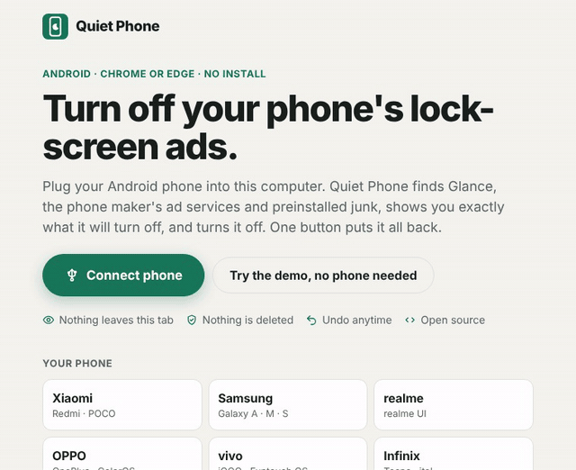

# Quiet Phone



**Your phone's lock-screen ads? One browser tab turns them off.**

Quiet Phone is a web page that talks to your Android phone over a USB cable. Pick the phone's
brand, and it lists the lock-screen ad feed (Glance, Wallpaper Carousel, Lock Screen Magazine),
the phone maker's ad and tracking services, and the preinstalled junk it can switch off, each with
a one-line reason. Press the button and they're off. Nothing is deleted, every change is written
down, and one button puts it all back.

No install, no account, no root. It runs in Chrome or Edge.

### [Open Quiet Phone](https://cig13zs.github.io/quiet-phone/)

Or [try the demo](https://cig13zs.github.io/quiet-phone/?demo=xiaomi) first: the same page
against a pretend Redmi, so you can see every step without plugging anything in.

[](https://ko-fi.com/jju1s)

> **Early release.** The flow and the safety checks are tested against a simulated phone, and the lists come from public reports, not from every model in hand. If you try it on a real phone, tell me what worked and what didn't with the [Add my phone](https://github.com/cig13zs/quiet-phone/issues/new/choose) form. Start with one safe item, and keep the restore file.

## What you need

- An Android phone and a USB cable that carries data (some charging cables don't).
- Chrome or Edge on a computer (Windows, macOS, Linux or ChromeOS), or Chrome on a second
  Android phone with a USB-C cable or OTG adapter.
- Two minutes to turn on USB debugging. The page shows the steps for your brand.

## How it goes

1. On the phone, turn on Developer options and USB debugging. (Settings › About phone › tap
   Build number seven times; Xiaomi calls it OS version or MIUI version.)
2. Plug it in, open the page and press **Connect phone**. Chrome lists USB devices; pick yours.
3. The phone asks "Allow USB debugging?" with an RSA key fingerprint. Tap **Allow**. The key was
   made by your browser and stays in it; it's how the phone recognises this tab next time.
4. Quiet Phone reads the phone's model and installed apps, picks the brand, and shows the list.
   Safe items are ticked. Caution items are shown unticked with what you'd lose. Expert items are
   hidden unless you ask for them.
5. Press **Turn off 9** (or however many). Each app flips to Off as it goes.
6. Save the restore file if you like. Lock the phone and wake it: the lock screen is your
   wallpaper again.

Some ads are settings rather than apps, so the last screen also lists the switches to flip in
Settings for your brand (lock-screen stories, personalised ads, "recommendations" in the maker's
own apps, the advertising ID).

## Supported phones

Brands are picked for where Glance and maker ads are most common: the Philippines, Southeast Asia
and India. One button per brand.

| Brand | Turned off by the one button (safe) | Offered with a warning (caution, expert) |
|---|---|---|
| Xiaomi, Redmi, POCO (MIUI, HyperOS) | Wallpaper Carousel (Glance for Mi), MSA system ads, Analytics, App Vault, Quick Apps, Games, Feedback | MIUI Daemon, GetApps, Cleaner, Mi Video, Mi Music, Mi Browser, Joyose |
| Samsung (One UI) | Glance, Samsung Free, AppCloud (ironSource), Digital Turbine installer, Visit In, Galaxy Widget, Tips | Customization Service, recommended-apps installers, Game Launcher, Dynamic Lock Screen, Bixby Voice |
| realme (realme UI) | Lock Screen Magazine, opos ad service, User Experience Program, Hot Apps folders, instant game ads, O Roaming | HeyTap push, App Market, Browser, Theme Store, Games, Shelf, Security check |
| OPPO, OnePlus (ColorOS) | Same as realme | Same as realme, without Security check |
| vivo, iQOO | Lockscreen Poster | V-Appstore, swipe-left feed, Global Search, Browser, i Theme, Jovi, vivo push |
| Infinix, Tecno, itel (XOS, HiOS) | Magazine lock screen, Palm Store, AHA Games, Palm Store updater, Chrome Assistant, TECNO SPOT, XClub, Carlcare | Phone Master, Hi Browser, Phoenix Browser, Folax, Magic Show player, TranCare |
| Motorola | Motorola Notifications, Digital Turbine installer, MotoApps (ironSource), Moto feedback, demo mode | App Box, Device Help |
| Honor (MagicOS) | Magazine unlock, Smart diagnosis, plus the Huawei list for older Honor phones | AI Suggestions, Game Suite, HONOR App Market |
| Huawei (EMUI) | Magazine unlock, folder "recommended apps", ironSource installer | HiBoard / Huawei Assistant |

On every brand it also offers Glance under any package name (`com.glance.*`), Meta's preinstalled
installer and services, the Netflix partner hook, and, unticked, the Gemini app.

Only what is actually on your phone is shown. 92 entries in all, in [`data/lists`](data/lists),
each with a risk level, a reason and at least one source. A phone that isn't covered? Use the
**Add my phone** issue form; `npx quiet-phone scan --json` gives the package names.

## Exactly what it changes

For each app you leave ticked, it runs this over USB, for user 0 (you):

```
pm disable-user --user 0 <package>
```

That's the same switch as Settings › Apps › Disable, which most phones hide for their own apps.
The app stays installed, keeps its data, and can't run until it's enabled again.

Some phones (several MIUI builds, for example) refuse `disable-user` for their own apps. Then,
only if the "remove it for my user instead" option is on (it is by default, and the page says so),
it runs:

```
pm uninstall -k --user 0 <package>
```

That removes the app for your user only. The APK stays in the system image, so it can always
come back, and a factory reset brings it back too. Each result row says which of the two was
used.

Before each command, the change is written to the restore record, so a cable pulled halfway still
leaves an accurate record.

## Restore

**Restore everything** works through the record, newest first:

- an app that was removed for your user gets `cmd package install-existing --user 0 <package>`
  (or `pm install-existing` on older Android);
- an app that is disabled gets `pm enable --user 0 <package>`.

It checks the phone's state after each step, so running it twice is harmless.

The record lives in three places:

- in this browser, per phone;
- on the phone itself, in `Download/quiet-phone-restore.json`, so any computer can undo the
  changes;
- in the restore file you save (`quiet-phone-restore-<model>-<date>.json`), which **Load a
  restore file** takes back.

Big system updates sometimes switch these apps on again. Connect again and Quiet Phone says how
many came back and ticks them.

## Safety model

- **Only listed packages.** It never changes a package that isn't on the lists, whatever the
  selection or a restore file says.
- **An essential denylist that can't be overridden.** System UI, Settings, telephony, Bluetooth,
  NFC, storage providers, Play services and the Play Store, WebView, package installers,
  emergency alerts, launchers, keyboards and setup wizards are in [`data/essential.json`](data/essential.json),
  checked when the plan is built and again right before each command.
- **Your phone's own essentials too.** At connect time it asks the phone which launcher, keyboards,
  phone app and SMS app are in use, and keeps those, even if a list names them.
- **Instalment-plan locks are off limits.** Knox Guard, Android Device Lock and PayJoy are on the
  denylist: on a phone bought on credit, touching them can lock it.
- **Risk levels.** Safe items are ticked. Caution items need a tick and a confirmation that lists
  them. Expert items need expert mode as well.
- **No shell injection.** Every argument sent to the phone must be a plain word (letters, digits,
  `._:/=-`); package names are checked against Android's naming rules.
- **Preview first.** Nothing changes until you press the button, and the button says how many.

## Limits

- It needs a USB cable and Chrome or Edge. Firefox and Safari don't support WebUSB, and iPhones
  aren't Android.
- Only one program can hold the phone's debugging connection. Close Android Studio, scrcpy and
  similar tools, or run `adb kill-server`, before connecting.
- On Windows, the phone may need its maker's USB driver (or Google's) before Chrome can see it.
- Phone makers update their apps and occasionally rename them, and system updates can switch
  things back on. Connect again after a big update.
- Menu names in the Settings steps move around between OS versions.
- Ads inside apps you installed yourself (YouTube, games, browsers) are out of reach.
- It can't touch anything that needs root, and doesn't try.

## Privacy

Everything happens in the tab. There's no server, no account, no analytics and no cookies. The
page's Content Security Policy blocks requests to any other site, so the only network traffic is
loading the page itself from GitHub Pages. The ADB key is created by your browser and kept in its
IndexedDB. The restore record holds your phone's serial number, model and the package names that
were changed; it stays in your browser's storage, on the phone, and in any file you save.

## Command line and agents

The same plan runs through Android's `adb` on your computer:

```bash
npx quiet-phone scan             # what's on the phone and what would be turned off
npx quiet-phone apply            # asks before changing anything
npx quiet-phone restore          # puts everything back
npx quiet-phone scan --demo xiaomi   # try it against the pretend Redmi
```

`--only`, `--include-caution`, `--expert`, `--brand`, `--serial`, `--json` and `--yes` are
explained by `npx quiet-phone --help`. It refuses to change anything without a yes: a prompt in a
terminal, or `--yes` in a script. Restore records go to `~/.quiet-phone/` and to the phone.

[`SKILL.md`](SKILL.md) lets a coding agent run it for someone the same careful way: list
what's on the phone, show the table, wait for a yes, then act.

## Where the lists come from

The lists were written for this project. Each entry's reason is our own wording, and each has at
least one public source: the app's Play Store or Galaxy Store page, the maker's support pages,
Pithus and Exodus Privacy analyses, press coverage (The Verge, Android Police, XDA, SMEX), and
community reports. Package names and behaviour were cross-checked against the community list in
[UAD-ng](https://github.com/Universal-Debloater-Alliance/universal-android-debloater-next-generation),
which is GPL-3.0; none of its descriptions or list structure were copied, which is why Quiet
Phone can be MIT. Contributions follow the same rule: write the reason yourself and link a source.

## Build

Needs Node 20 or later (CI uses 24).

```bash
npm install
npm run dev          # local site with hot reload (WebUSB works on localhost)
npm test             # unit tests: lists, denylist, plan, apply, restore, restore file, web UI, adb
npm run build        # dist/ (the site) and dist-cli/quiet-phone.mjs (the CLI)
npm run e2e          # Playwright: the built site against the demo phone, then the CLI
npm run media        # re-records docs/media and public/og.png (needs ffmpeg)
```

| Path | Does |
|---|---|
| `data/lists/*.json` | The package lists: label, category, risk, reason, sources. |
| `data/brands.json` | Brand buttons, how a phone is matched, setup steps and Settings steps. |
| `data/essential.json` | Packages that are never touched. |
| `src/core/` | Reading the phone, plan building, apply, restore and the restore file. Shared by the site and the CLI. |
| `src/core/fake-device.ts` | The pretend phone used by the tests and the demo. |
| `src/web/` | The site, and the WebUSB connection through [Tango (ya-webadb)](https://github.com/yume-chan/ya-webadb). |
| `src/cli/` | The command line, through local `adb`. |
| `e2e/` | End-to-end test, media recorder, and a server that mimics GitHub Pages. |

Pushes to `main` deploy the site to GitHub Pages (`.github/workflows/pages.yml`).

## Licence

MIT. Not affiliated with Google, Glance, or any phone maker. If it gave you a quiet lock screen,
you can [buy me a coffee](https://ko-fi.com/jju1s).
